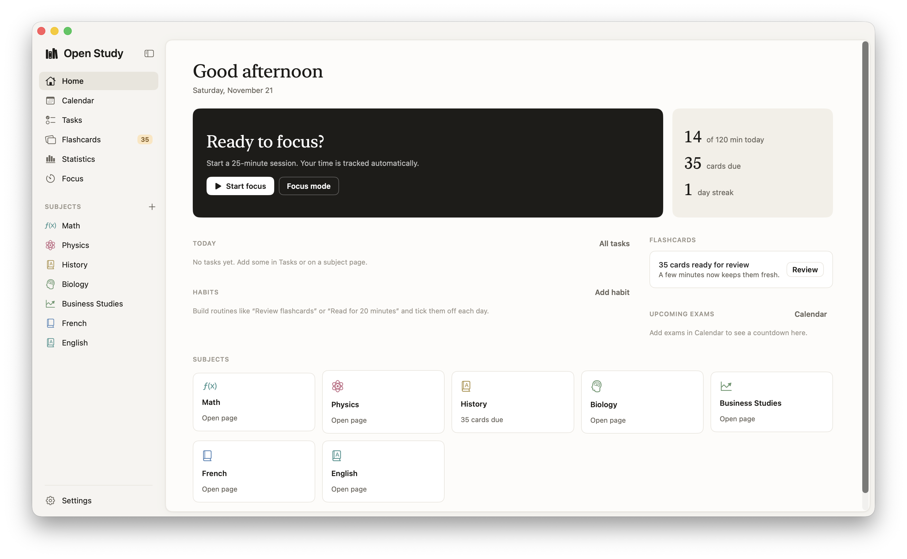

<div align="center">


# Open Study

**A calm, private study workspace for macOS.**
Notes, flashcards, PDFs, quizzes, tasks and a focus timer — organised by subject, stored only on your Mac.

[](LICENSE)
[](https://github.com/theopenlauncher/open-study/releases)
[](#requirements)
[](https://www.swift.org)
[](https://developer.apple.com/xcode/swiftui/)
<br>
[](https://github.com/theopenlauncher/open-study/commits/main)
[](https://github.com/theopenlauncher/open-study/issues)
[](CONTRIBUTING.md)
[](https://github.com/theopenlauncher/open-study/stargazers)

[Download](#download) · [Features](#features) · [Build from source](#building-from-source) · [Contributing](CONTRIBUTING.md) · [Security](SECURITY.md)

</div>

---

<!--
  Screenshot placeholder: add a light-mode screenshot of the Home screen at
  docs/screenshots/home.png (a 2560×1640 capture of the default window size works well).
  The image below will render once that file exists.
-->
<p align="center">
  
</p>

## Overview

Open Study is a native macOS app that brings everything a student needs into one quiet, well-lit workspace. Each **subject** is a free-flowing page — in the spirit of a Notion document — that you build from blocks: rich notes, flashcard decks, annotated PDFs, quizzes, task lists, a Pomodoro timer and progress charts.

It is designed around a few firm principles:

- **Local-first and private.** Your notes, cards, files and history live in a database on your Mac. There is no account, no sync service and no internet requirement.
- **Blank by default.** A new subject is an empty page; you decide what goes on it. The app never fills your workspace with sample content.
- **Honest data.** Every number on screen — streaks, due cards, focus minutes — is computed from your real activity.
- **Native first.** Real macOS controls, menus, keyboard shortcuts, notifications and focus rings, with full light and dark mode support.

## Features

### Subjects and pages

- Organise your work into **subjects**, each with its own colour and SF Symbol, and split them into **topic pages** you can reorder or move between subjects.
- Build pages from **11 block types**, inserted from a `/` command menu or a `+` popover:

  | Block | What it does |
  | --- | --- |
  | Text | Rich notes with headings, lists, checklists, links, images, tables and code |
  | Heading · Divider · Callout | Structure a page and highlight key ideas (five callout tones) |
  | Checklist | A quick checklist that lives on the page |
  | Task list | Tasks with due dates that also appear in the global Tasks view |
  | Flashcards | Review a deck with spaced repetition, right on the page |
  | PDF document | Read and annotate a PDF inline |
  | Pomodoro timer | A focus timer tied to the subject |
  | Study statistics | Progress charts for the subject |
  | Quiz | A practice test you can take and retake |

### Rich notes

- Built on `NSTextView`, so native lists, tables, spell-checking and text services just work.
- **Markdown-style shortcuts** at the start of a line: `#`, `##`, `###`, `-` / `*`, `1.`, `[]` and ` ``` `.
- A floating formatting bar appears only while you edit; **⌘B / ⌘I / ⌘U** toggle bold, italic and underline.
- Paste or drop images, then resize them by dragging or choose Small, Medium, Large or Fit Width.

### Flashcards with spaced repetition

- Reviews are scheduled with the **SM-2** algorithm using four ratings — *Again*, *Hard*, *Good*, *Easy* — each showing its next interval before you choose.
- Keyboard-driven review: **Space** reveals the answer and **1–4** rate the card.
- **Import cards** from CSV or plain text in an Anki-style workflow: detect or pick a separator (comma, tab, semicolon, pipe or custom), map columns to Front / Back / Tags, and preview each row (Ready · Duplicate · Missing back) before importing.

### PDF reader

- A native PDFKit reader with **highlights**, **sticky notes** and an annotations list, inline on a page or in its own window.
- Imported PDFs are **copied into the app**, so they keep working if the original is moved or deleted. Annotations are saved back into that copy.

### Focus timer

- A configurable **Pomodoro** timer with short and long breaks, optional auto-start, an alert sound of your choice and system notifications.
- A distraction-free **Focus mode**, plus a live timer pill in the window's top strip so you can see time remaining from any screen.
- Focus sessions are logged per subject and feed your statistics and daily goal.

### Planning and progress

- **Tasks** — grouped into Overdue, Today, Upcoming and No date, with priorities, subjects, filters and sorting.
- **Calendar** — a month view of study sessions, exams and due tasks, with an agenda and upcoming exam countdowns.
- **Quizzes** — multiple-choice, true/false and short-answer questions, with scored attempts and a review of mistakes.
- **Habits** — daily study habits with streaks, a 7-day strip and a 16-week history heatmap.
- **Statistics** — study time, reviews per day, focus by subject and an activity heatmap over 7, 30 or 90 days.
- **Home** — a daily dashboard with today's focus time, cards due, your streak, due tasks, habits and upcoming exams.

## Download

Pre-built versions of Open Study are published on the **[Releases page](https://github.com/theopenlauncher/open-study/releases)**.

1. Download the latest release for macOS.
2. Move **Open Study** into your **Applications** folder.
3. Open it. On first launch you may be asked to allow notifications so the focus timer can tell you when a session ends.

> [!NOTE]
> Open Study is in early development. If no release is listed yet, or you want the latest changes, [build it from source](#building-from-source).

## Requirements

| | Minimum |
| --- | --- |
| **Run** | macOS 26.5 or later |
| **Build** | Xcode 26 or later (with the macOS 26.5 SDK) |

## Building from source

1. **Clone the repository**

   ```bash
   git clone https://github.com/theopenlauncher/open-study.git
   ```

2. **Open the project in Xcode**

   ```bash
   open open-study/open-study.xcodeproj
   ```

   Xcode resolves the only external dependency, [PostHog](https://github.com/PostHog/posthog-ios), through Swift Package Manager automatically.

3. **Configure signing.** In the `open-study` target's **Signing & Capabilities** tab, choose your own team, or select *Sign to Run Locally*. Please don't commit this change.

4. **Run** the `open-study` scheme with **⌘R**.

To build from the command line instead (ad-hoc signed, for local use only):

```bash
xcodebuild -project open-study.xcodeproj -scheme open-study -configuration Debug CODE_SIGN_IDENTITY=- build
```

See [CONTRIBUTING.md](CONTRIBUTING.md) for the full development workflow, including the visual snapshot harness.

## Keyboard shortcuts

| Shortcut | Action |
| --- | --- |
| **⌘1** – **⌘6** | Go to Home, Calendar, Tasks, Flashcards, Statistics, Focus |
| **⇧⌘N** | New subject |
| **⌃⌘S** | Show or hide the sidebar |
| **⌥⌘P** | Start or pause the timer |
| **⇧⌘F** | Enter or exit Focus mode |
| **⌘T** | Jump to today (Calendar) |
| **⌘N** | New event (Calendar) · add card (when viewing a deck) |
| **⌘R** | Review all due cards (Flashcards) |
| **Space** · **1–4** | Show answer · rate card (during review) |
| **⌘B** · **⌘I** · **⌘U** | Bold · italic · underline (in notes) |
| `/` | Open the block menu on an empty line |

## Privacy and data

### Where your data lives

Open Study runs in the macOS **App Sandbox**. Everything you create is stored on your Mac, inside the app's container:

```
~/Library/Containers/xyz.elipseday.open-study/Data/Library/Application Support/OpenStudy/
├── OpenStudy.store      # SwiftData database: subjects, pages, blocks, cards, tasks, history…
└── Documents/           # Your imported PDFs, including annotations
```

You can open this folder at any time from **Settings → Data → Show Data Folder in Finder**. iCloud / CloudKit sync is deliberately disabled. To back up or move your data, quit the app and copy the `OpenStudy` folder.

The app only requests **read-only** access to files you explicitly choose (for importing PDFs, images and flashcards), plus outgoing network access for optional usage data.

### Anonymous usage data

Open Study can send a small amount of anonymous usage data to [PostHog](https://posthog.com) to help improve the app. This is **on by default** and can be turned off at any time in **Settings → Privacy → Share anonymous usage data**. When it is off, the analytics SDK is never started (or is shut down immediately), so the app makes no requests to PostHog at all.

When it is on, Open Study sends only:

- that the app started, and whether its database opened successfully;
- when a focus session is saved: its length, whether it was completed, and whether it was linked to a subject (not which one);
- automatically captured error and crash reports.

**Your notes, card text, task titles, subject names and files are never sent.**

## Project structure

```
open-study/
├── open_studyApp.swift      # App entry point: windows, menus, SwiftData container
├── ContentView.swift        # Main window: sidebar + workspace
├── Models/                  # SwiftData models (Subject, TopicPage, Block, Deck, TaskItem, …)
├── Services/                # Non-UI logic
│   ├── StudyLogic.swift     #   SM-2 scheduling and streaks (pure functions)
│   ├── PomodoroEngine.swift #   Timer state machine, preferences, notifications
│   ├── CardImporter.swift   #   CSV / text flashcard parsing
│   ├── DocumentStore.swift  #   PDF import, storage and annotation saving
│   ├── TopicPages.swift     #   Creating, moving and deleting topic pages
│   ├── AppRouter.swift      #   Navigation state
│   └── Analytics.swift …    #   Opt-out usage data (PostHog)
├── Views/                   # SwiftUI screens, one folder per feature
├── Design/                  # Theme tokens (Theme.swift) and shared components
└── Debug/                   # DEBUG-only UI snapshot harness
docs/design-reference/       # Visual references used by DESIGN.md
DESIGN.md                    # The design system: colour, type, layout and behaviour rules
```

## Design

Open Study's look and behaviour are specified in **[DESIGN.md](DESIGN.md)** — the single source of truth for colour tokens, typography, spacing, components and per-feature rules. Its guiding idea is *a calm desk, not a cockpit*: warm neutrals, generous whitespace and colour used only for meaning. Design changes are made to that document first, then implemented in [`Theme.swift`](open-study/Design/Theme.swift) and [`Components.swift`](open-study/Design/Components.swift).

## Contributing

Contributions are welcome — bug reports, feature ideas, documentation and code. Please read the **[contributing guide](CONTRIBUTING.md)** before opening a pull request, and follow our **[Code of Conduct](CODE_OF_CONDUCT.md)**.

## Security

Please **do not** report security vulnerabilities in public issues. See **[SECURITY.md](SECURITY.md)** for how to report them privately.

## License

Open Study is free software, licensed under the **[GNU Affero General Public License v3.0](LICENSE)**. You may use, study, share and modify it, provided that any distributed or network-served modified version is also made available under the same license.

## Acknowledgements

- [PostHog](https://github.com/PostHog/posthog-ios) for the optional, opt-out analytics SDK.
- The **SM-2** spaced-repetition algorithm by Piotr Woźniak (SuperMemo).
- Apple's SwiftUI, SwiftData, PDFKit and AppKit frameworks, which do most of the heavy lifting.
